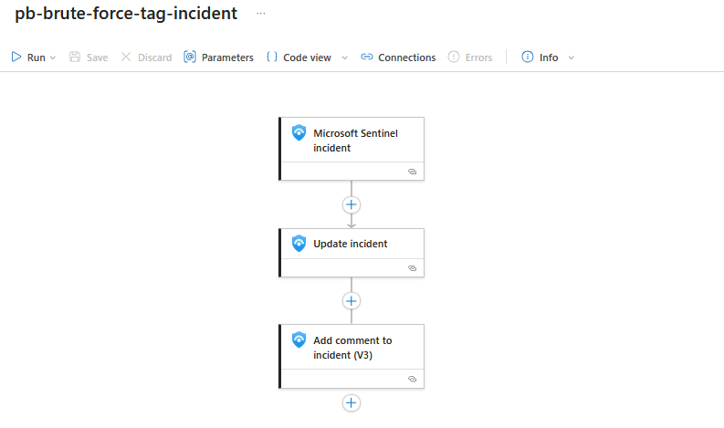
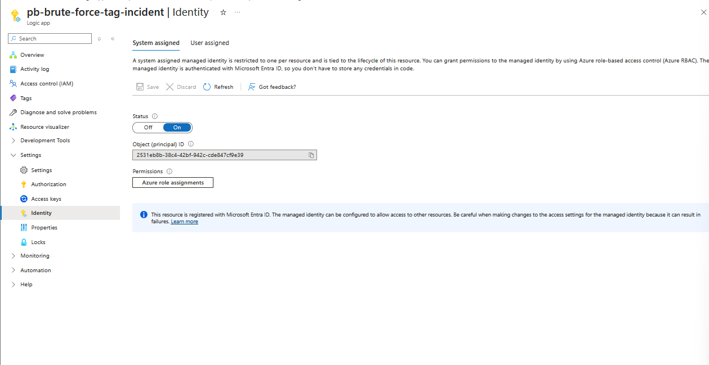
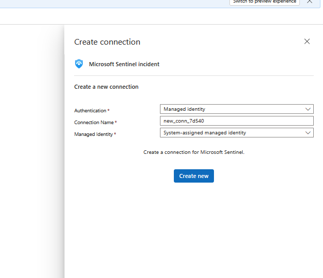
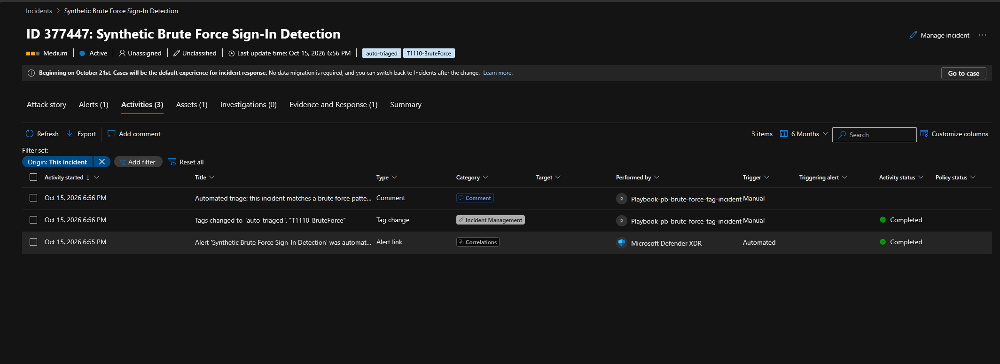
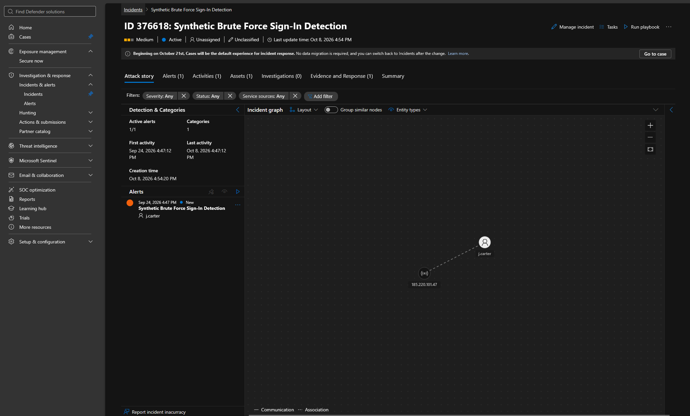
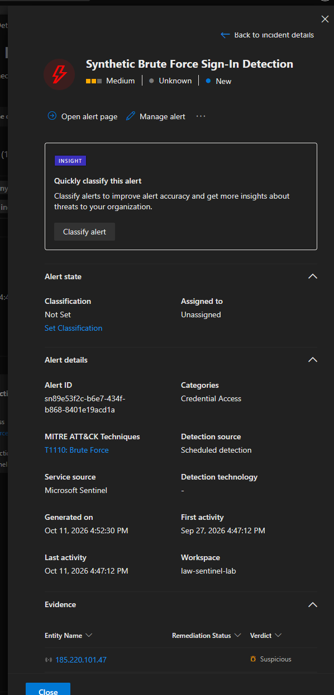
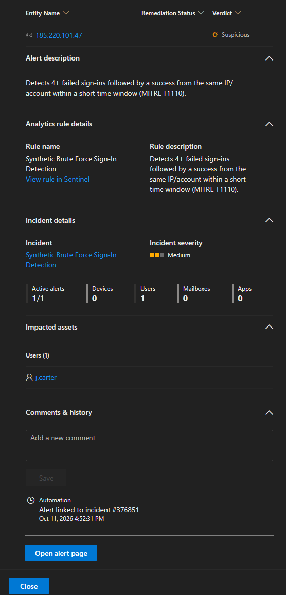
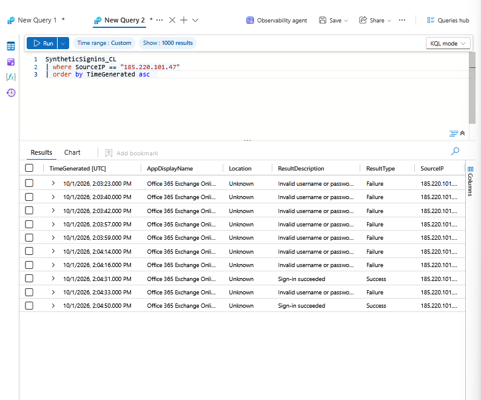
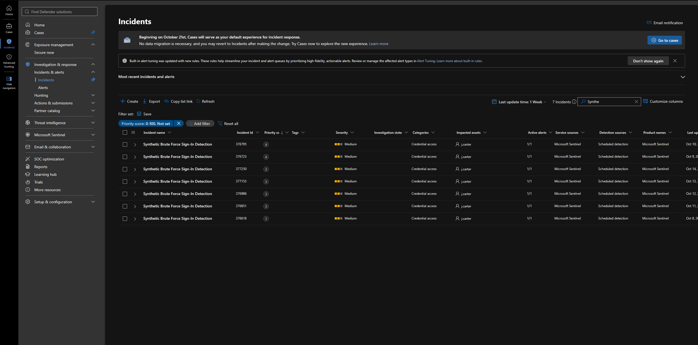

# Brute Force Sign-In Detection in Microsoft Sentinel

A detection engineering use case built end to end in Microsoft Sentinel: synthetic telemetry generation and ingestion, a KQL detection, a scheduled analytics rule mapped to MITRE ATT&CK T1110.001 (Brute Force: Password Guessing), incident investigation and triage, and a SOAR playbook that triages new incidents automatically.

> All telemetry in this project is synthetic. It is generated by a script I wrote and ingested into my own Log Analytics workspace. No real accounts, users or sign-ins are involved, and the account and domain names are made up.

## Architecture

```
Python generator -> Data Collection Endpoint + Rule -> SyntheticSignins_CL -> Analytics rule (KQL)
                                                                                    |
                                                                                    v
         Logic App playbook (tag + comment)  <-  Automation rule  <-  Incident
```

- **Generator:** `scripts/ingest_synthetic_signins.py` produces synthetic sign-in events for several attack patterns (brute force, password spray, impossible travel). This document covers the brute force pattern: 4 failed sign-ins about 17 seconds apart, then a success, from one IP against one account.
- **Authentication:** the script uses my Azure CLI sign-in, which holds the Monitoring Metrics Publisher role on the Data Collection Rule (Azure RBAC). No secrets or keys are stored.
- **Ingestion:** Azure Monitor Logs Ingestion API through a Data Collection Endpoint and Data Collection Rule.
- **Storage:** custom table `SyntheticSignins_CL` with 7 columns: `TimeGenerated`, `UserPrincipalName`, `SourceIP`, `ResultType`, `ResultDescription`, `Location`, `AppDisplayName`.
- **Detection:** a scheduled Sentinel analytics rule running the KQL below.
- **Response:** an automation rule runs a Logic App playbook on every incident the rule creates (see Automated response).

## Detection logic

Query: `kql-queries/brute-force-signin-detection.kql`

```kql
SyntheticSignins_CL
| where TimeGenerated > ago(1h)
| summarize
    FailedAttempts = countif(ResultType == "Failure"),
    SuccessAttempts = countif(ResultType == "Success"),
    TotalAttempts = count(),
    FirstFailure = minif(TimeGenerated, ResultType == "Failure"),
    LastEvent = max(TimeGenerated)
    by SourceIP, UserPrincipalName
| extend TimeSpan = LastEvent - FirstFailure
| where TimeSpan < 5m and FailedAttempts >= 4 and SuccessAttempts >= 1
| extend TimeGenerated = LastEvent
```

For each source IP and account pair, the query counts failures and successes, measures how long the activity lasted, and alerts when there are at least 4 failures and at least 1 success within 5 minutes. A burst of failures followed by a success from the same source is the typical sign of a guessed password.

## Analytics rule configuration

| Setting | Value |
|---|---|
| Name | Synthetic Brute Force Sign-In Detection |
| Type | Scheduled query rule |
| Severity | Medium |
| MITRE ATT&CK | Credential Access, T1110.001 Brute Force: Password Guessing |
| Schedule | Every 1 hour, looking back 1 hour |
| Alert threshold | More than 0 results |
| Entity mapping | Account (Name) to `UserPrincipalName`, IP (Address) to `SourceIP` |
| Incident creation | Enabled, alert grouping off |

The entity mapping feeds the investigation graph, so the account and the IP appear as linked entities on the incident.

## Automated response (SOAR)

A Logic App playbook triages every new brute force incident as soon as it is created. The workflow definition is in `playbooks/pb-brute-force-tag-incident.json` (subscription ID removed).

| Component | Detail |
|---|---|
| Playbook | Logic App `pb-brute-force-tag-incident`, Consumption plan |
| Trigger | Microsoft Sentinel incident |
| Action 1 | Update incident: adds the tags `auto-triaged` and `T1110-BruteForce` |
| Action 2 | Add comment to incident: posts the triage guidance below |
| Authentication | System-assigned managed identity with the Microsoft Sentinel Responder role on the resource group. No stored credentials and no app registration. |
| Automation rule | "Brute force - auto-tag and comment": when an incident is created and the analytics rule name contains "Synthetic Brute Force Sign-In Detection", run the playbook |
| Sentinel permission | Microsoft Sentinel Automation Contributor granted to the Azure Security Insights service on the playbook's resource group, which allows Sentinel to run playbooks |

Comment added to each incident:

> Automated triage: this incident matches a brute force pattern (MITRE T1110). Next steps: confirm whether the successful sign-in was legitimate, reset the account password and revoke active sessions, check MFA status, block the source IP, and review the account's activity after the success.





**Testing.** I ran the playbook by hand on an existing incident, and the tags and comment appeared in its Activities panel. I then tested the full chain. After new synthetic events were ingested, the analytics rule created incident 377447 at 6:55 PM, and the playbook added both tags and the comment at 6:56 PM with no manual action.



The portal lists the playbook's entries with Trigger set to "Manual". That column does not show who started the run: no one ran the playbook by hand here, the automation rule did, which the timestamps confirm.

## Investigation

**1. Incident review.** Medium severity, Credential Access, one alert, one impacted user. The incident graph links the account `j.carter` to the IP `185.220.101.47`.



**2. Alert review.** The alert is tagged T1110, comes from the scheduled analytics rule in workspace `law-sentinel-lab`, and the IP is marked Suspicious in the evidence list.




**3. Evidence in the raw logs.** I queried the table for the suspect IP and read the events directly:

```kql
SyntheticSignins_CL
| where SourceIP == "185.220.101.47"
| order by TimeGenerated asc
```



The query returns 10 events between 14:03:23 and 14:04:50 UTC on 1 October: 8 failed sign-ins ("Invalid username or password") and 2 successful ones, all against Office 365 Exchange Online from the same IP and account. Seven failures occur in under a minute before the **first successful sign-in at 14:04:31**.

**4. Conclusion.** Repeated failures from one external IP followed by a success within minutes matches a brute force attack that likely ended in a compromised account.

## Analyst note

> Between 2:03 and 2:04 PM UTC on 1 Oct, IP 185.220.101.47 made 7 failed sign-in attempts against j.carter's Office 365 Exchange Online account within about a minute, then signed in successfully at 2:04:31 PM. This matches a brute force attack (T1110) and the account is likely compromised. Recommended actions: reset the password and revoke active sessions, confirm MFA status, block the IP, review what the account did after 2:04:31 PM (mailbox rules, forwarding, other sign-ins), and check whether the same IP targeted other accounts. Telemetry is simulated for this lab.

## Triage outcome

The incident is classified as **Informational, expected activity (Security testing)**, because the activity is a deliberate simulation.

## Rule tuning

- **Schedule and lookback.** The rule runs every hour and looks back one hour, so every event is evaluated by exactly one run. A daily schedule with a 14 day lookback re-evaluates the same events on each run and raises a repeated incident every time, as in the list below.
- **Alert time.** The query returns the time of the last event as `TimeGenerated`, so the alert shows when the activity happened and not the whole query window.


